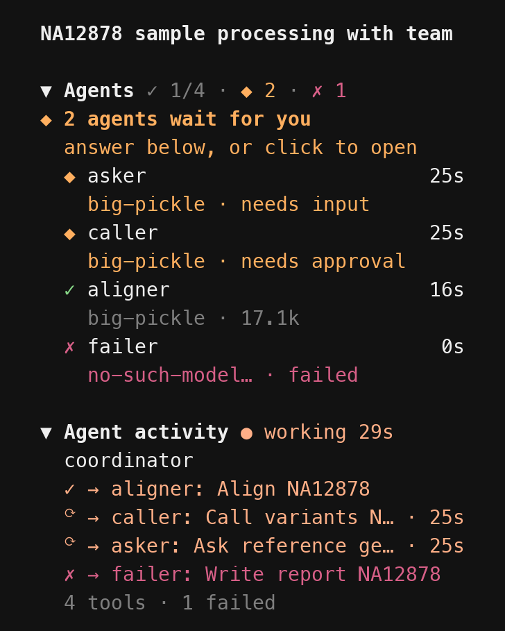

# opencode-sidebar-plus

Do you want [OpenCode](https://opencode.ai) to tell you when a long command has
finished, with a sound and, while you are in another window, a desktop
notification? To see at a glance what every agent is working on, and which one is
waiting for you? To run a command in the terminal without leaving OpenCode? Then
this sidebar is for you.



*Rendered from the real TUI (ayu-dark theme): a coordinator has started four
specialists in parallel. Two are done; two wait for a shell approval, which
OpenCode asks for under the conversation.*

## What you get

- **Agents**: every sub-agent as a live tree, with what it is doing, its model,
  time and tokens. One waiting for your approval or answer is flagged at once;
  click it to open its conversation.
- **Alerts in the sidebar**, not pop-ups over it: `✓ 5 agents finished`,
  `◆ aligner needs approval`, `⚠ context 72% full`. A long command finishing also
  plays a sound, and sends a desktop notification while you are in another window.
- **▶ Run**: run a command in the chat (the agent sees the output) or in the
  background, and run a finished one again with a click.
- **≡ Details**: a timeline of when each agent worked, and its tokens, tool calls
  and commands; optionally saved as a Markdown report.
- **Context, to-do list and activity**: how full the context window is, the
  agent's task list, and the tool it is running right now.
- **⚙ Options** (or `/sidebar`): presets and every switch in one menu.

Works with OpenCode **2.0.16 or later** (tested in the real TUI on 2.0.29); not with
OpenCode 1.x, whose plugin format is different.

## Install

Clone a release into a project's `.opencode/plugins/` folder; OpenCode loads
plugins from there by itself:

```bash
git clone -q --depth 1 --branch v0.3.1 https://github.com/dskanakoglou/opencode-sidebar-plus .opencode/plugins/sidebar-plus
```

Git notes that the tag "is not a commit" and that you are on a "detached
HEAD"; both are expected when cloning a release. For every project, clone it
anywhere and list the folder in your global `~/.config/opencode/opencode.json`:

```json
{ "plugins": ["/absolute/path/to/opencode-sidebar-plus"] }
```

**Not with a `github:` entry for now.** On OpenCode 2.0.29 a plugin installed
as `"github:dskanakoglou/opencode-sidebar-plus#v0.3.1"` (or with `opencode plugin
add github:…`) loads, but the sidebar is drawn once and never updates. Loaded
from a folder it works.

Restart OpenCode after installing. Then, in `~/.config/opencode/cli.json`, hide
OpenCode's own context line, which this sidebar replaces, and turn on sounds and
desktop notifications:

```json
{
  "plugins": ["-opencode.sidebar.context"],
  "attention": { "notifications": true, "sound": true, "volume": 0.4 }
}
```

**No sidebar?** OpenCode shows it from 121 columns, and only once a conversation
has started. On a narrower terminal press `ctrl+x b`; while it is hidden the
prompt footer says `sidebar hidden · ctrl+x b`, and a sub-agent waiting for you is
named just above the prompt.

<details>
<summary><b>Other ways to install</b></summary>

A project can also point at a copy inside the repository (`"./vendor/sidebar-plus"`;
`./` paths are resolved against the project), or keep one in
`.opencode/plugins/sidebar-plus/` (a clone, as above, or a copy of `tui.tsx`,
`server.ts`, `src/` and `package.json`), which OpenCode finds without a `plugins`
entry. For a local folder
OpenCode loads `<folder>/tui.tsx` and `<folder>/server.ts` directly, so keep both
at the root.

The plugin has two halves: `tui.tsx`, the sidebar, and `server.ts`, which gives the
agent a small `todo` tool (OpenCode v2 has no `todowrite`, so without it there is
no task list to show). Nothing needs building; OpenCode compiles both itself.
**Sidebar only**, without the `todo` tool: leave `opencode.json` alone and list the
plugin in `cli.json` instead:

```json
{ "plugins": ["-opencode.sidebar.context", "/absolute/path/to/opencode-sidebar-plus"] }
```

</details>

<details>
<summary><b>The Agents section</b></summary>

The Agents section is a live view of a multi-agent run: every sub-agent
delegated from the conversation, and the sub-agents *they* delegated to, as an
indented tree. It appears at the top of the sidebar as soon as the first
sub-agent starts, and stays hidden in conversations without any. The screenshot
above shows it mid-run.

**Header.** How the team is doing: `3/5 done · 1 running · 1 waiting · $0.02`,
in the theme's colours per state. When that does not fit, the same counts as
glyphs (`✓ 3/5 · ● 1 · ◆ 1 · $0.02`). Zero counts are left out; the cost (the
whole conversation, sub-agents included) shows once it is above $0.

**Waiting banner.** While any sub-agent waits for a permission or an answer, a
bold line in the theme's warning colour sits under the header, even when the
section is collapsed: `◆ caller needs approval`, or `◆ 2 agents wait for you`.
OpenCode shows a sub-agent's permission prompt or question under the main
conversation, so you can answer it there. Clicking the banner opens the agent
that has waited longest.

**Rows.** Two lines per agent: status, name and elapsed time (live while it
runs, its final duration afterwards); then model, what it is doing, tokens and
cost. The status words are never cut; a long tool target is.

| Glyph | Meaning |
|---|---|
| `●` | running: the tool it is running, `thinking`, or `starting…` before its first step has finished |
| `◆` | waiting: `needs approval` (a permission prompt) or `needs input` (a question) |
| `✓` | done |
| `✗` | failed |
| `⊘` | interrupted, or stopped because its question was dismissed |
| `○` | queued |

- Running and waiting agents come first, newest first; then finished ones, most
  recently finished first. Children follow their parent.
- Every running or waiting agent is listed. Finished ones are capped at
  `agentsShown` (default 8), with a `+N more finished` line.
- Tokens include cache reads and writes, like the Context section. OpenCode adds
  a step's tokens when the step ends, so a fresh agent shows `starting…` or its
  current tool until then.
- Click an agent to open its conversation; `esc` brings you back. In **Agent
  activity**, delegations read `→ aligner: <description>`, and clicking one
  opens that sub-agent too.

Nested delegation (a sub-agent starting its own sub-agents) needs
`"experimental": { "subagent_depth": 2 }` or more in `opencode.json`.

The plugin observes delegation; it does not create or coordinate agents.

</details>

<details>
<summary><b>Every section</b></summary>

| Section | Contents |
|---|---|
| **Context** | A usage bar coloured by threshold, used/limit/free tokens, the last step's breakdown (input, output, reasoning, cache), a sparkline of context size per step, when auto-compaction will kick in, how many compactions have happened, and cost. It also warns when the provider seems to **truncate input**: the same power-of-two input count on every step, typical of Ollama's default `num_ctx`. |
| **Task list** | The agent's to-do list: ☐ pending, ◐ in progress, ☑ completed, ⊘ cancelled. Needs the server half. |
| **Agent activity** | Running or ready and for how long; the last few tool calls with a live timer on the current one; tool count and failures; retries; the last error; and a **loop warning** when the model keeps calling the same tool on the same target. |
| **Terminal commands** | Commands the agent ran and background shells, with live timers, exit codes and durations. |
| **Files** | Files written, edited or patched in this session, and the git branch. |
| **Details panel** | **≡ Details** opens a full-width panel: a timeline with one lane per agent on a shared time axis, a per-agent table (model, state, time, tokens, cost, tools, failures, commands, with totals), context growth, a per-turn table and the last 40 tool calls. `esc` closes it. |

Sections with nothing to show are hidden. Terminal commands, off in the Minimal
and Agents presets, also shows once you start a background command with **▶ Run**.
Click a heading (`▼` / `▶`) to collapse or expand it; this is remembered. Colours
come from your theme.

Task lists are what the agent reports, not proof of completion. Loop and
truncation warnings are heuristics. Files lists recorded tool operations, not
every file a shell command touched.

</details>

<details>
<summary><b>Buttons, Run, pointer and reports</b></summary>

The foot of the sidebar holds three buttons, in every preset:

- **▶ Run** asks for a command, then where to run it. **In chat** works like `!`
  in the prompt: the output goes into the conversation, so the agent can read it.
  **In background** runs it on its own; it shows under Terminal commands with a
  live timer and its exit code. The last choice is remembered.
- Clicking a finished command under Terminal commands offers **Run again** (in
  chat or in background) or **Edit, then run…**. Nothing runs on the click itself.
- **≡ Details** opens the details panel.
- **⚙ Options** opens the same menu as `/sidebar`: Run a command, Session details
  and Save run report first, so everything stays reachable while the sidebar is
  hidden; then the presets, every switch, sidebar sound, run reports, and reset.

Section headings, agent rows, the waiting banner, delegations under Agent activity
and finished commands are clickable too. In terminals that support pointer shapes
(OSC 22: iTerm2 3.5+, kitty, Ghostty, foot, xterm) the pointer is an arrow over
OpenCode and a hand over anything clickable in the sidebar; the terminal's own
pointer comes back when OpenCode exits.

**Run reports** (off by default; turn on under ⚙ Options, or `"report": true`).
**↓ Save report** in the details panel, or "Save run report" in the menu, writes a
Markdown summary of the run (timeline, per-agent table, every command with the
agent that ran it, files changed) to `reports/<title>-<date>-<time>.md` in the
session folder, or a path you type.

</details>

<details>
<summary><b>Alerts</b></summary>

OpenCode already notifies when a session finishes or fails, plays its own
sounds for sub-agents, and toasts a failed sub-agent. The plugin adds alerts for
what is not covered. They appear in a strip at the top of the sidebar, newest
first, at most three, one line each, instead of pop-ups over it: a click opens
the session an alert is about, `×` dismisses it, and lines fade after a minute
(warnings and errors after two). Repeats merge into one line, so five sub-agents
finishing read `✓ 5 agents finished`. While the sidebar is hidden, or with
"Alerts in sidebar" switched off under ⚙ Options, they pop up instead, one at a
time and merged the same way. OpenCode's own pop-ups are outside the plugin's
reach.

- a sub-agent **needs approval** or **has a question** (at most one alert per
  agent per 30 seconds; the banner stays up for as long as anything waits),
- a sub-agent finished or was interrupted,
- a command ran longer than `shellNotifyAfter` seconds and finished (also a
  desktop notification while the terminal is unfocused),
- context crossed `warnAt` or `dangerAt`,
- the agent looks stuck in a loop, or input looks truncated.

Sub-agent alerts make no sound of their own, so nothing pings twice. The context,
loop and truncation alerts fire once per session, while it runs.

"Sidebar sound" under ⚙ Options mutes the plugin's own command-alert sound; it
does not change OpenCode's sounds. Notifications need attention enabled in
`~/.config/opencode/cli.json`:

```json
"attention": { "notifications": true, "sound": true, "volume": 0.4 }
```

</details>

<details>
<summary><b>Turning things on and off</b></summary>

Click **⚙ Options** (or run `/sidebar`, or "Sidebar options" in the command
palette) and pick a preset. The change applies at once and is remembered.

| Preset | Shows |
|---|---|
| **Minimal** | Context bar and task list |
| **Agents** (default) | Context bar, task list, Agents with the waiting banner, and Agent activity |
| **Full** | Everything, including token numbers, sparkline, terminal commands and files |

Alerts and hints stay on in every preset, and the buttons are always there. Below
the presets the menu lists every switch with its state (`on`/`off`), grouped as in
the table below; Enter flips one and the menu stays open on it. Type to filter.
"Reset to config defaults" forgets what was picked in the menu.

| Group | Switches |
|---|---|
| Sections | `context`, `todo`, `activity`, `shells`, `files`, `subagents` (Agents) |
| Hints | `hints` (the `ctrl+x b` hint while the sidebar is hidden, and the start-screen line) |
| Context | `context.bar`, `context.numbers`, `context.breakdown`, `context.sparkline`, `context.compaction`, `context.truncation`, `context.cost` |
| To-do | `todo.done` (keep finished items visible) |
| Activity | `activity.tools`, `activity.loop`, `activity.errors` |
| Files | `files.branch` |
| Agents | `subagents.top` (Agents first while there are sub-agents), `subagents.banner` (the waiting banner) |
| Alerts | `alerts.context`, `alerts.loop`, `alerts.truncation`, `alerts.commands`, `alerts.agents` |

</details>

<details>
<summary><b>Options</b></summary>

Sidebar options go on an object entry in `cli.json` (this works alongside an
`opencode.json` entry; the sidebar still loads once):

```json
{
  "plugins": [
    "-opencode.sidebar.context",
    {
      "package": "/absolute/path/to/opencode-sidebar-plus",
      "options": { "preset": "full", "features": { "context.sparkline": false } }
    }
  ]
}
```

| Option | Default | Meaning |
|---|---|---|
| `preset` | `"agents"` | `"minimal"`, `"agents"` or `"full"`. If unset but `sections` or `features` is given (a v0.1 config), the base is `"full"`, as in v0.1 |
| `features` | per preset | On/off for any switch above, on top of the preset |
| `sections` | all | Section order. Sections left out start switched off |
| `agentsShown` | `8` | Finished sub-agents listed before `+N more finished` |
| `warnAt` | `70` | Context % for the warning colour and alert |
| `dangerAt` | `90` | Context % for the error colour and alert |
| `compactionBuffer` | unset | Your `compaction.buffer` (for example `2048`), to show "compacts at …" |
| `recentTools` | `5` | Tool calls listed under Agent activity |
| `loopThreshold` | `3` | Same-tool, same-target calls in a row before the loop warning (minimum 2) |
| `shellNotifyAfter` | `20` | Seconds a command must run before its completion is announced |
| `toasts` | `true` | `false` turns off the context, loop and truncation alerts (the name is kept from v0.1) |
| `report` | `false` | `true` allows saving run reports until switched under ⚙ Options |

Server option, on the `opencode.json` entry: `{ "todo": false }` leaves out the
`todo` tool.

</details>

<details>
<summary><b>Things to know</b></summary>

- The `todo` tool's description and schema add about 170 tokens to every
  request; `{ "todo": false }` removes them. The agent sends its whole list on
  every call (the shape of v1's `todowrite`), and the sidebar shows the latest
  one from the session history, so nothing extra is stored.
- Context numbers use the built-in widget's formula: all token counts of the last
  assistant step against the model's `limit.context`.
- The plugin reads data the TUI already has and sends nothing over the network.
  It runs only the commands you start with **▶ Run** or **Run again**, and writes
  a file only when you save a run report. Its UI state (collapsed sections,
  preset, switches, sound, reports, where Run last ran) goes to
  `~/.local/state/opencode/latest/tui/plugin.sidebar-plus.*.json`.
  Switches saved by v0.1 keep applying, on top of the Full layout they were made
  against.
- OpenCode does not show the sidebar while you look at a sub-agent's
  conversation; `esc` returns to the main one.

</details>

<details>
<summary><b>Development</b></summary>

```sh
npm install   # types only; OpenCode provides solid-js and @opentui at runtime
npm run check # type-check against the @opencode/plugin types
npm test      # node --test on the pure logic in src/derive.ts
```

- `src/derive.ts` holds the logic as pure functions (the agent tree, header
  summary, waiting banner, presets, timeline, per-agent table, alerts and the run
  report) with tests in `test/`.
- `src/widgets.tsx` holds the views and a per-session memo shared by every
  section; `tui.tsx` the wiring, the Options menu, Run, alerts and the pointer;
  `server.ts` the `todo` tool.
- `scripts/tuirun.py` drives the real TUI in a pseudo-terminal and prints the
  rendered screen as text (needs `pip install pyte`); its docstring lists the
  steps. `scripts/render.py` turns one of its snapshots into the screenshot above.

</details>

<details>
<summary><b>Acknowledgements</b></summary>

This plugin was built on, or learned from, the following projects. None of their code is copied here, except that the plugin uses the OpenCode, OpenTUI and SolidJS packages at runtime, as every OpenCode TUI plugin does.

**Built on**

- **[OpenCode](https://github.com/anomalyco/opencode)** (MIT): the host application, its v2 plugin SDK (`@opencode/plugin`) and its client types. Several choices here come from reading its built-in plugins:
  - the context formula matches its `opencode.sidebar.context` widget;
  - its `opencode.notifications` plugin showed which alerts were already covered;
  - the `todo` tool's arguments follow v1's `todowrite`.
- **[OpenTUI](https://github.com/anomalyco/opentui)** (MIT): the terminal UI renderer and its SolidJS bindings (`@opentui/core`, `@opentui/solid`).
- **[SolidJS](https://github.com/solidjs/solid)** (MIT): the reactivity the sidebar is built on.
- Pointer shapes follow [kitty's OSC 22 description](https://sw.kovidgoyal.net/kitty/pointer-shapes/) and [Ghostty's compatibility notes](https://ghostty.org/docs/vt/osc/22); the X11 names iTerm2 accepts come from [its source](https://github.com/gnachman/iTerm2/blob/v3.6.6/sources/PTYSession.m).

**Inspiration and prior art**

- **[streetturtle/opencode-better-sidebar](https://github.com/streetturtle/opencode-better-sidebar)** (MIT), by streetturtle with contributions from Major Hayden. Its OpenCode v1 sidebar plugins (`context-progress`, `session-tokens`, `recap`, `open-in`) started this project. The context bar and token counting here follow the approach of `context-progress`, re-implemented for the v2 plugin API.
- **[frap129/opencode-rules, issue #74](https://github.com/frap129/opencode-rules/issues/74)**: a write-up of how the TUI slot API changed from v1 to v2, which pointed this project at the right v2 API.
- Other OpenCode sidebar plugins, whose descriptions helped decide which features to include:
  - [SolitudeRA/opencode-tui-context](https://github.com/SolitudeRA/opencode-tui-context) (token-composition breakdown),
  - [Dqz00116/opencode-agents-monitor](https://github.com/Dqz00116/opencode-agents-monitor) and [psh4607-works/opencode-agent-sidebar](https://github.com/psh4607-works/opencode-agent-sidebar) (sub-agent monitoring),
  - [jonasotoaguilar/opencode-tokenmeter](https://github.com/jonasotoaguilar/opencode-tokenmeter) (delegation tree),
  - [shiv-source/opencode-usage-panel](https://github.com/shiv-source/opencode-usage-panel) (per-model usage),
  - [graychaos44/opencode-tps-sidebar](https://github.com/graychaos44/opencode-tps-sidebar) (tokens per second).
- **[awesome-opencode](https://github.com/awesome-opencode/awesome-opencode)**: the curated list that makes plugins like these findable.

**Development and testing**

- **[pyte](https://github.com/selectel/pyte)** (LGPL-3.0): the terminal emulator behind `scripts/tuirun.py`. It is used for testing only and is not shipped with the plugin.
- **[TypeScript](https://github.com/microsoft/TypeScript)** (Apache-2.0) and the Node.js test runner.
- **[Ollama](https://github.com/ollama/ollama)** with Qwen3 8B, for local test runs. Those runs revealed the `num_ctx` truncation that the Context section now detects.
- OpenCode's free `opencode/big-pickle` model, for test runs without a context cap.

</details>
